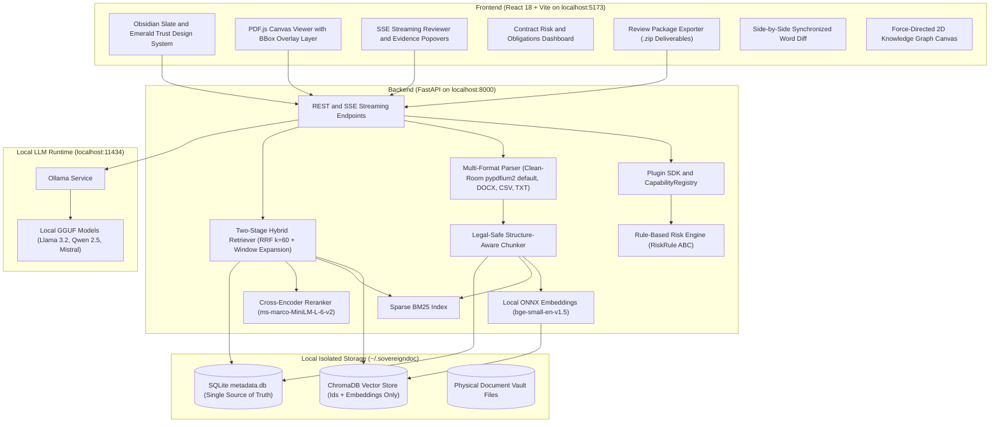

# SovereignDoc - System Architecture & Technical Specifications

---

## 1. Executive Summary & Design Principles

**SovereignDoc** is an air-gapped, zero-telemetry, local-first AI Document Intelligence and Second Brain platform. It is engineered with four non-negotiable architectural axioms:
1. **Zero External Sockets**: Zero telemetry, zero external API dependencies, zero cloud font/asset CDNs during runtime operation. All compute executes on the local host. (Initial setup and build-time downloads require standard network access unless deploying pre-packaged offline container bundles).
2. **Deterministic Source Grounding & Provenance**: Every finding, risk, or obligation links to an exact bounding-box coordinate `[x0, y0, x1, y1]` on a rendered PDF canvas, with explicit `detection_method` and `confidence` score for complete legal explainability.
3. **Deterministic Review Reproducibility**: Given the identical document and identical ruleset version, risk and obligations findings are 100% deterministic and reproducible across multiple runs.
4. **Decoupled Plugin Architecture**: The open-source AGPL Community Edition is complete and functional standalone, exposing clean capability interfaces (`CapabilityRegistry` and `RiskRule` ABC) for commercial extensions without conditional `if pro:` codebase contamination.

---

## 2. System Architecture Diagram



---

## 3. The Plugin Architecture (plugin-sdk) & Bounded Context

SovereignDoc implements the Open-Core plugin pattern (similar to VSCode, Obsidian, and Grafana):
- The **AGPL Community Core** defines abstract capability interfaces and maintains a central registry.
- **Commercial Pro / Enterprise plugins** live in separate repositories and register dynamically at startup.

### Bounded Context Package Structure
```
packages/
└── contract-intelligence/
    ├── __init__.py
    ├── enums.py                      # RiskLevel, DetectionMethod, ClauseCategory, ObligationParty
    ├── plugin_sdk/                   # CapabilityRegistry, BaseCapability, RiskRule ABC
    ├── classifiers/                  # ClauseClassifier, heuristics, FastEmbed exemplars
    ├── risk_rules/                   # Built-in RiskRule implementations (confidence = 1.0)
    ├── obligations/                  # ObligationsExtractor, duty & deadline parsers
    ├── diff/                         # ContractDiffEngine, LCS word diff, clause aligner
    └── exports/                      # ReviewPackageExporter (.zip deliverables)
```

### Core Capability Registry
```python
class CapabilityRegistry:
    _capabilities: Dict[str, Any] = {}

    @classmethod
    def register(cls, capability_name: str, implementation: Any):
        cls._capabilities[capability_name] = implementation

    @classmethod
    def get(cls, capability_name: str, default=None):
        return cls._capabilities.get(capability_name, default)
```

### RiskRule Base Class Architecture
```python
class RiskRule(ABC):
    id: str
    name: str
    severity: RiskLevel  # HIGH, MEDIUM, LOW
    category: ClauseCategory

    @abstractmethod
    def evaluate(self, chunks: List[Any], classified_clauses: Dict[str, Any]) -> List[RiskAuditItem]:
        pass
```
- **Community** registers 9 built-in deterministic rules across the 7 core clause families (`ClauseCategory`):
  1. `UNCAPPED_LIABILITY` (High - Limitation of Liability: uncapped exposure and carve-outs)
  2. `ONE_SIDED_INDEMNITY` (High - Indemnification: unilateral indemnification duties)
  3. `MISSING_CAP` (High - Limitation of Liability: complete absence of liability ceiling)
  4. `SHORT_NOTICE` (Medium - Termination: tight notice/cure windows $\le$ 15 days)
  5. `EVERGREEN` (Medium - Termination: auto-renewal & perpetual post-termination survival)
  6. `FOREIGN_JURISDICTION` (Medium - Governing Law: non-standard offshore dispute forums)
  7. `AUDIT_AND_RECORDS_EXPOSURE` (Medium - Confidentiality: invasive books-and-records inspection, customer audit pass-throughs, and overpayment refund duties)
  8. `RESTRICTIVE_COVENANT_AND_IP` (Medium - Intellectual Property: multi-year post-termination non-solicitation and weekly source code deposit mandates)
  9. `OPERATIONAL_COVENANTS` (Low - Governing Law: formal notice delivery, authority representations, and self-funded further assurances)

*(Note: Inspection rights and audit covenants are systematically evaluated under `ClauseCategory.CONFIDENTIALITY` via `AUDIT_AND_RECORDS_EXPOSURE` and parsed into affirmative obligations by the obligations extractor).*
- **Pro** registers custom playbook rules and threshold checkers via the exact same interface without modifying the core execution engine.

---

## 4. Legal Explainability, Provenance & Confidence Calibration

Legal teams and researchers require knowing *why* something was flagged. Every identified risk and obligation stores:
1. `rule_id`: The exact rule or heuristic triggered.
2. `confidence`: Calibrated confidence score:
   - **Deterministic Pattern Matches**: `confidence = 1.0` and `detection_method = DetectionMethod.RULE`. (Prevents confusing legal users with fractional probabilities on hard rule matches).
   - **Probabilistic Extractions**: Calibrated fractional confidence ($0.50$ to $0.95$) for embedding proximity and LLM extraction.
3. `detection_method`: Typed enum (`RULE`, `REGEX`, `CLASSIFIER`, `EMBEDDING`, `LLM`).
4. `bbox`: Exact PDF canvas coordinates `[x0, y0, x1, y1]` for interactive visual confirmation.

---

## 5. Storage Architecture: Single Source of Truth & Versioned ReviewRuns

To optimize local memory and ensure audit integrity across large document vaults:
1. **SQLite (metadata.db) is the Single Source of Truth**:
   - Stores all document text, chunk content, clause metadata, bounding boxes, chat sessions, messages, obligations, and risk records.
2. **Versioned `ReviewRun` Execution Records**:
   - Every review execution records a non-destructive `ReviewRun` (`Review 1`, `Review 2`, `Review 3`), preventing in-place overwrites when contracts are amended and re-analyzed.
   - Child findings (`RiskAuditItem`, `ObligationItem`) link directly to `review_run_id`.
3. **ChromaDB Stores Vectors Only**:
   - Stores only `chunk_id` and embedding vectors. No raw text is duplicated in ChromaDB, cutting vector store disk usage in half.
4. **Sequential Chunk Linking**:
   - Chunks store `chunk_index`, `previous_chunk_id`, and `next_chunk_id`. This enables instant contextual expansion during retrieval hydration without re-querying the vector database.
5. **Unified Multi-Format Pagination & Clause Header Engine**:
   - `DocumentParser.paginate_docx` serves as the single shared pagination engine for both RAG chunk ingestion (`_parse_docx`) and Mammoth HTML sheet rendering (`get_document_html`), eliminating pagination drift between chat citations and the Document Viewer.
   - Supports a 3-tier `PaginationSource` hierarchy (`WORD_PAGE_BREAK` $\to$ `SECTION_BREAK` $\to$ `VIRTUAL_LAYOUT`) with intra-paragraph run break detection (`_inspect_element_breaks`).
   - Start-of-line anchored clause detection (`_parse_clause_header`) captures `Section X`, `Sec. X`, `§ X`, numbered clauses (`10. Title`), decimal clauses (`10.1`), and parenthesized sub-clauses (`(a)`), preventing mid-sentence cross-references from polluting section metadata.
6. **Document-Scoped Chat Sessions (`idx_chat_sessions_document_id`)**:
   - `ChatSession` links directly to `Document` (`document_id`) with an indexed foreign key and conservative backfill for legacy sessions, powering document-filtered session views (`This Doc` vs `All`) and automatic document switching.
7. **7-Entity Grounded Legal Knowledge Graph & Second Brain Usability Overhaul (`v1.1.0`)**:
   - `KnowledgeGraphService` (`graph_service.py`) persists `GraphNode` and `GraphEdge` records typed with strict `GraphNodeType` (`DOCUMENT`, `REVIEW_RUN`, `CLAUSE_CATEGORY`, `RISK`, `OBLIGATION`, `NOTE`, `TAG`) and `GraphEdgeType` (`CONTAINS`, `GENERATED`, `REFERENCES`, `TAGGED`, `LINKS_TO`) `StrEnum`s and versioned with `graph_version = "1.1.0"`.
   - **Current State vs. Timeline Decoupling**: Automatically annotates nodes with `is_latest: bool` and `run_number: int`. Defaults to `🎯 Current State` (displaying active legal state and reducing 60–80% of perceived graph complexity) while preserving `📚 Review Timeline` for multi-audit review histories.
   - **Clause Category Isolation**: Dynamically links `CLAUSE_CATEGORY -> OBLIGATION` (`IMPOSES`) and `CLAUSE_CATEGORY -> RISK` (`FLAGS`), allowing users to isolate single clauses (e.g. `Confidentiality (incl. Audit & Records)`, `Termination`, `Limitation of Liability`) down to clean 3–5 node constellations.
   - **Interactive Slide-Out Inspector Drawer (`GraphInspectorDrawer.jsx`)**: 420px right-hand slide-out panel showing structured risk/obligation breakdowns, syntax-highlighted verbatim quotes with `[📋 Copy Citation]`, connected neighbor breadcrumbs, `[📄 Open in Contract Viewer]`, and `[📝 Pin to Active Note]`.
   - **Zoom Level-of-Detail (LOD)**: Automatically adjusts label visibility based on camera zoom thresholds, culling leaf labels when zoomed out and expanding on zoom or hover to prevent font clumping.
   - **Zero-Click Hover Cards & Fast Hygiene Filters**: Provides instant hover discovery alongside Severity (`HIGH`, `MEDIUM`, `LOW`) and Party (`VENDOR`, `CUSTOMER`, `MUTUAL`) quick filter pills.
   - Enforces the **Graph Grounding Integrity** axiom: every `GraphNode` is traceable via `(entity_type, entity_id)` to a persisted SQLite record (100% grounded).
   - `NoteRecord` edits snapshot immutable `NoteVersion` records (`v1..vN`) enabling non-destructive version restore.
   - Forward-compatible `GraphNode.node_embedding` (`NULL` in Community) and `GraphEdge.metadata_json` columns support future Commercial Pro/Enterprise **Portfolio Graphs & Cross-Contract GraphRAG** without schema migrations.
8. **Multi-Layer Air-Gap Security Auditor (`audit_version = "1.0"`) & 25-Page E2E Benchmark Suite**:
   - `AirGapVerifier` (`airgap_verifier.py` / `verify_airgap.py`) enforces telemetry lockdown (`ANONYMIZED_TELEMETRY=False`, `DO_NOT_TRACK=1`, `HF_HUB_DISABLE_TELEMETRY=1`), scans frontend bundles for external CDN URLs, inspects live runtime sockets, and wraps synthetic pipeline runs in `MultiLayerEgressGuard` (intercepting `socket.connect`, `socket.create_connection`, `urllib.request`, `urllib3`, `httpx`, `requests`, and `aiohttp`).
   - `BenchmarkService` (`benchmark_service.py` / `benchmark_hardware.py`) profiles local hardware across a **25-page End-to-End Document Benchmark (`end_to_end_ms`)** as well as individual stages (FastEmbed ONNX `chunks/sec`, Cross-Encoder Reranker `pairs/sec`, deterministic `ReviewRun` latency, and 7-Entity Knowledge Graph grounding sync).
9. **Clean-Room Coordinate Inversion & 2-Stage Paragraph Clustering (`PDFiumParser`)**:
   - `PDFiumParser` (`backend/app/services/rag/pdf/pdfium_parser.py`) inverts PDF bottom-left coordinate systems into top-left web canvas bounding boxes `[x0, y0, x1, y1]` using native `pypdfium2` geometry.
   - **Stage 1 (Horizontal Line Assembly)**: Merges adjacent intra-line character runs and styled spans (e.g. bold numbering like `(q)`, quotes, and styled words) whose vertical midpoints align, ordering fragments left-to-right into continuous horizontal lines.
   - **Stage 2 (Paragraph Block Clustering)**: Evaluates vertical inter-line pitch ($\text{v\_gap} \le \max(5.5\text{ pt}, \text{line\_height} \times 0.75)$) to cluster lines into coherent paragraph-level clause blocks. This guarantees citation clicks highlight the entire legal clause on the PDF canvas rather than fragmented line slivers, providing sub-pixel coordinate parity with PyMuPDF.
10. **Document-Level Pre-Filtering Hybrid Retrieval Engine (`document_id` Scoping)**:
    - Solves multi-contract candidate starvation in vaults containing multiple contracts of varying sizes.
    - **Dense Vector Search Pre-Filtering**: `ChromaVectorStore.search` applies native metadata filters (`where={"document_id": document_id}`) directly to the vector index during retrieval.
    - **Sparse BM25 Index Candidate Scoping**: `BM25Index.search_sparse` restricts candidate scoring and ranking to chunks matching the target `document_id` (`self.chunks[i]["document_id"] == document_id`).
    - **Guaranteed Evidence Allocation**: When a document is focused in the Document Viewer, candidates passed to Reciprocal Rank Fusion ($k=60$) and Cross-Encoder Reranking (`ms-marco-MiniLM-L-6-v2`) are guaranteed to belong to that active document, preventing larger contracts in the same vault from monopolizing all top-k candidate slots.
    - **Universal Query Support**: Works seamlessly for both free-form manual natural-language questions and preset prompt recipes (`Obligations & Deadlines`, `Liability & Indemnity`, `Termination Triggers`, `Executive Briefing`).
    - **Vault-Wide Fallback**: When `document_id` is omitted (`None`), the retrieval engine pools candidates globally across all vault documents without filtering.
